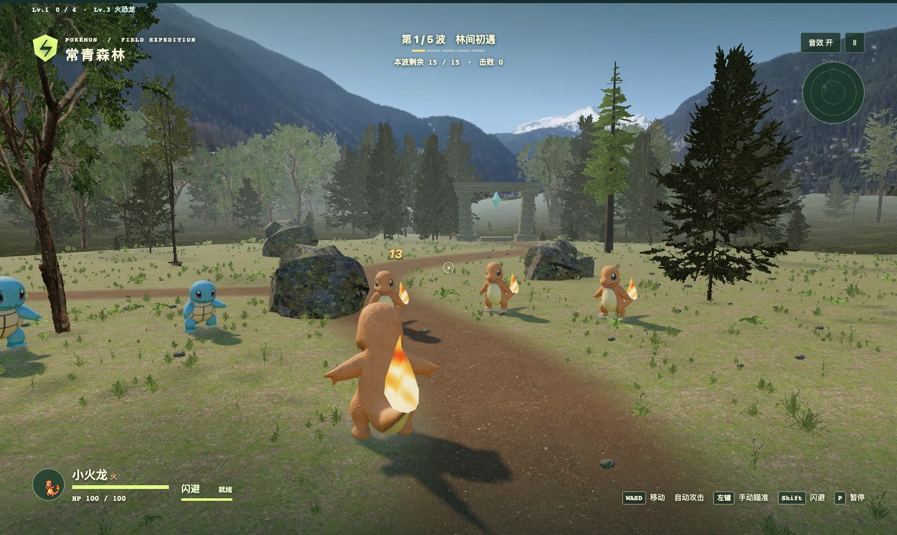

# 常青秘境 · 宝可梦生存挑战

一款在浏览器里玩的第三人称 3D 生存游戏。选一只宝可梦进入森林，边走位边自动攻击，拾取经验晶石，从随机出现的三项强化中选一项，迎战五波敌人。



## 伙伴与进化

| 开局伙伴 | 玩法 |
| --- | --- |
| 小火龙 | 3 级进化为火恐龙，6 级成为喷火龙。扇形火焰扫过敌群，还能叠加灼烧与爆破。 |
| 杰尼龟 | 3 级进化为卡咪龟，6 级成为水箭龟。双肩水炮贯穿前排，击中时对周围敌人造成溅射。 |
| 皮卡丘 | 用电击自动迎敌，通过连锁、贯穿和攻速强化扩大打击范围。 |

## 本地试玩

在装有 Python 3 的电脑上运行以下命令。Three.js、角色模型、林地贴图和音效逻辑都随项目提供。

```sh
git clone https://github.com/zaojie/pokemon-arena.git
cd pokemon-arena
python3 -m http.server 8846 --bind 127.0.0.1
```

打开 [本地游戏](http://127.0.0.1:8846/)，选好伙伴后点击「进入战斗」。用 WASD 移动，Shift 闪避，鼠标转动视角，左键手动瞄准，P 暂停。升级时也可以按 1、2、3 选择强化。

## 素材来源

本作是非官方同人游戏。宝可梦角色及名称归相应权利方所有。角色模型、头像、环境素材及 Three.js 许可见[角色来源](assets/character-sources.txt)、[环境来源](assets/environment-sources.txt)和 [Three.js 许可证](assets/three-LICENSE.txt)。
